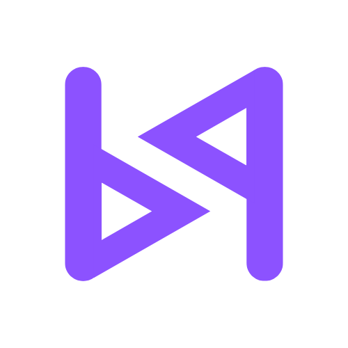

<p align="center">
  
</p>

# Web Development: HTML, SQL & Flask

An 11-week course for students aged 13 to 22, from **Bit by Bit Coding (BbB)**: build a database-driven website with HTML, SQL and Flask. Each week is a 3-hour session: a live demo, challenges, extra practice, a one-page cheatsheet and worked answers. The course ends with a capstone project that students plan, build, test and present.

[](https://codespaces.new/bitbybitcoding/Web-Development-HTML-SQL-Flask?quickstart=1)

**One click, nothing to install.** The button opens this repository in GitHub Codespaces, in a browser, with Python, Flask, the SQLite tools and the starter database `school.db` ready. It works on an iPad.

> **Students:** click the button above. When the Codespace has opened (about a minute the first time), open the folder for the current week and read its `README.md`.
> **Instructors:** see [Setting up a class](#instructors-setting-up-a-class) below. For a class, each student should have their **own copy** of the repository.

---

## The course

| Week | Topic | Block |
|------|-------|-------|
| [1](week-01-html-structure/) | HTML structure: tags, links, images, semantic layout | 1. HTML |
| [2](week-02-tables-forms-css/) | Tables, forms and CSS | 1. HTML |
| [3](week-03-select/) | SQL: `SELECT`, `WHERE`, `ORDER BY`, `NULL` | 2. SQL |
| [4](week-04-aggregates-joins/) | Aggregates, `GROUP BY`, joins, subqueries | 2. SQL |
| [5](week-05-database-design/) | Database design: ER diagrams, normalisation (1NF to 3NF) | 2. SQL |
| [6](week-06-ddl-dml-python-sqlite/) | `CREATE`, `INSERT`, `UPDATE`, `DELETE`; Python and SQLite; SQL injection | 2. SQL |
| [7](week-07-flask-routes-templates/) | Your first Flask app: routes and templates (**SQL checkpoint quiz** first) | 3. Flask |
| [8](week-08-forms-http-methods/) | Forms and HTTP methods: GET, POST, validation, Post/Redirect/Get | 3. Flask |
| [9](week-09-flask-sqlite-crud/) | Flask and SQLite: create, read, update, delete | 3. Flask |
| [10](week-10-plan-and-build/) | Capstone: plan and build (**mini-assessment**) | 4. Capstone |
| [11](week-11-test-polish-present/) | Test, polish and present | 4. Capstone |

### How each week's folder is organised

| File or folder | What it is |
|----------------|------------|
| `README.md` | The session plan (warm-up, demo, break, challenges, extra practice), objectives and instructor notes |
| `demo.md` and `demo/` | The live demo script, with the finished code |
| `challenges.md` and `challenges/` | Three or four challenges (the last is open-ended), with any starter files |
| `extra-practice.md` | Extra practice for fast finishers and homework |
| `cheatsheet.pdf` | A one-page quick reference for students |
| `Answers/` | Worked answers, mark schemes and automated checks |

Every session follows the same timetable: warm-up (15 min) · demo (45 min) · break (10 min) · challenges (80 min) · extra practice (30 min). Weeks 7, 10 and 11 differ slightly (a quiz, the mini-assessment and presentations); their READMEs say how.

### Assessment

| Component | Weight | Where |
|-----------|--------|-------|
| SQL checkpoint quiz | 15% | [Week 6 quiz](week-06-ddl-dml-python-sqlite/checkpoint-quiz.md), held in the first 20 minutes of Week 7 |
| Weekly challenges | 25% | Each week's `challenges.md` |
| Mini-assessment | 20% | [Week 10](week-10-plan-and-build/mini-assessment.md) |
| Capstone project | 40% | [Brief](week-10-plan-and-build/capstone-brief.md) and [marking sheet](week-11-test-polish-present/Answers/capstone-marking-sheet.md) |

The course is designed with Singapore-Cambridge GCE A-Level H2 Computing topics in mind (databases, SQL, normalisation, web applications, security habits), and includes exam-style written questions in the Week 5 and Week 10 extra practice. It is a teaching resource, not an official syllabus.

---

## Students: working in Codespaces

1. Click the **Open in GitHub Codespaces** button. Sign in to GitHub if asked.
2. Put **your own work** in a folder called `my-work/` (create it the first time). The weeks' instructions tell you what to put where.
3. Useful commands:

   | To... | Type |
   |-------|------|
   | Preview an HTML page | `python3 -m http.server 8000` (then open port 8000 in the **Ports** tab) |
   | Open the database | `sqlite3 school.db` |
   | Run a Flask app | `flask --app app run --debug` (from the folder with `app.py`; open port 5000) |
   | Stop a running program | `Ctrl+C` |
   | Save your work to GitHub | `git add -A`, then `git commit -m "what I did"`, then `git push` |

4. **When you finish, stop your Codespace** (green Codespaces button at the bottom left → *Stop current codespace*), and delete old ones at [github.com/codespaces](https://github.com/codespaces). Each account has a limited free allowance of Codespaces time.
5. The starter database `school.db` is shared by everyone. Week 9 apps work on a **copy** in `instance/`, so you cannot damage the original. To start again, delete the copy.

---

## Instructors: setting up a class

### One copy per student

Codespaces opened straight from this repository by someone who does not own it cannot save to it. Two ways to run a class:

1. **Recommended: make it a template.** On GitHub, open the repository's **Settings** and tick **Template repository**. Each student then clicks **Use this template → Create a new repository** (private is fine) and opens a Codespace from *their* copy. Their work is saved under their own account, and you can add them as collaborators to review it.
2. **Quick try-out.** Students use the button above. On their first `git push`, GitHub offers to create a fork for them.

### The dev container

The `.devcontainer/` folder defines the environment (Python 3.12, Flask, the `sqlite3` tool, a friendlier sqlite3 setup, and VS Code extensions including the SQLite Viewer). It:

- asks for a **2-core machine** (`hostRequirements`), the smallest size, which is enough for this course and best for free allowances;
- forwards port **5000** (Flask) and labels port **8000** (the HTML preview server);
- sets large fonts and autosave, suitable for an iPad;
- builds `school.db` if it is missing.

The first start takes about a minute while the container is built. *The dev container was written and checked for syntax in an environment without Docker, so please open one Codespace yourself before the first class and run `python3 tools/check_all.py` in its terminal.*

### Reminders

- Ask students to **stop and delete old codespaces** (GitHub's free allowance is shared by all of a person's Codespaces, and the allowance can change: check GitHub's current limits). Codespaces also stop themselves after an idle period.
- The `Answers/` folders are **public** because this repository is public. If you need a secure assessment, keep a private copy of the repository for yourself and delete `Answers/` from the version students see, or change the names and numbers in the quiz and mini-assessment (the Week 10 README explains how).
- The repository name has no colon, comma or ampersand because GitHub does not allow them in repository names (the course title is "Web Development: HTML, SQL & Flask").

### Maintaining the course

```bash
python3 tools/check_all.py              # checks the structure, PDFs, database, every answer app, tests and links
python3 tools/make_school_db.py         # rebuilds school.db (deterministic: the same data every time)
pip install reportlab
python3 tools/build_cheatsheets.py      # rebuilds the 11 cheatsheet PDFs from tools/cheatsheets/weeks_*.py
```

To change a cheatsheet, edit the text in `tools/cheatsheets/weeks_a.py` (Weeks 1 to 6) or `weeks_b.py` (Weeks 7 to 11), then run `build_cheatsheets.py`. Each sheet is checked to stay on one page.

### Not covered (and why)

- **User accounts and logins.** The capstone deliberately has no login; the final week's "Where next" points to it.
- **Deployment** is a stretch goal ([guide](week-11-test-polish-present/deploy-pythonanywhere.md)); it needs an account with an outside hosting service, whose rules for young users the instructor must check. The steps were not tested in this repository's build.

---

## About

Made for **Bit by Bit Coding (BbB)**, a youth-led non-profit offering zero-cost programming pathways for students aged 13 to 22 in Singapore: [www.bbbcoding.org](https://www.bbbcoding.org).

The sample data (students, CCAs, scores) is invented. No real people are described.
