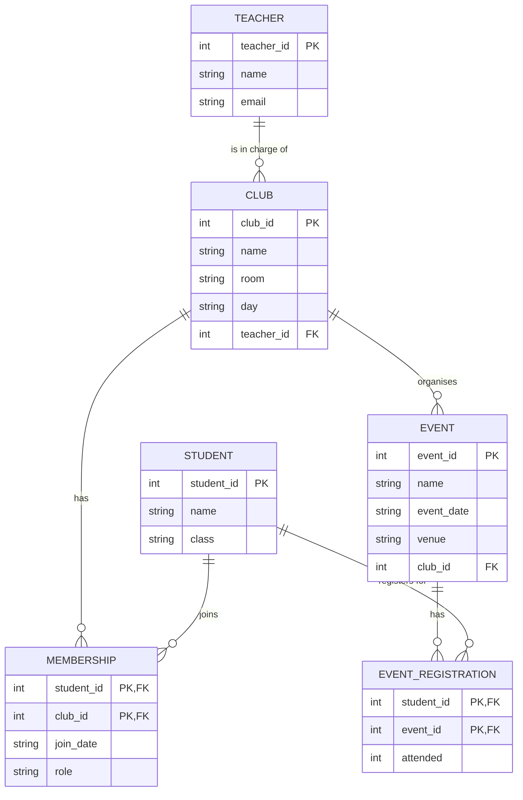

# Week 5, Challenge 1: ER diagram for the school club system

## 1. Entities, attributes and keys

| Entity (table) | Attributes | Primary key |
|----------------|------------|-------------|
| TEACHER | teacher_id, name, email | `teacher_id` (invented) |
| CLUB | club_id, name, room, day, teacher_id | `club_id` (invented) |
| STUDENT | student_id, name, class | `student_id` (invented) |
| EVENT | event_id, name, event_date, venue, club_id | `event_id` (invented) |
| MEMBERSHIP *(junction)* | student_id, club_id, join_date, role | `(student_id, club_id)` |
| EVENT_REGISTRATION *(junction)* | student_id, event_id, attended | `(student_id, event_id)` |

## 2 and 3. Relationships

| Relationship | Type | How it is implemented |
|--------------|------|-----------------------|
| A teacher is in charge of clubs | 1:M (one teacher, many clubs; each club has exactly one teacher) | `club.teacher_id` is a FK to `teacher` |
| A club organises events | 1:M | `event.club_id` is a FK to `club` |
| Students join clubs | **M:N** | junction table `membership`; it holds `join_date` and `role` because they describe *this student in this club* |
| Students register for events | **M:N** | junction table `event_registration`; it holds `attended` because it describes *this student at this event* |

## 4. ER diagram

## 5. Where the foreign keys go

The foreign key is always on the **"many" side**: `club.teacher_id` (many clubs per teacher) and `event.club_id` (many events per club). The two junction tables hold two foreign keys each.

## Marking notes

- The diagram does **not** have a direct line between STUDENT and CLUB, or between STUDENT and EVENT. Those would be many-to-many and must be resolved.
- Cardinality at the teacher end of the TEACHER-CLUB line is `||` (exactly one): "every club has exactly one teacher-in-charge". At the club end it is `o{` (a teacher may be in charge of zero or many clubs).
- Accept reasonable variations: a surrogate key on the junction table, or `STUDENT.class` moved into its own table (this is valid, but not required by the description).
- `event_registration.attended` could be NULL until the event has happened. A good answer notes this.
