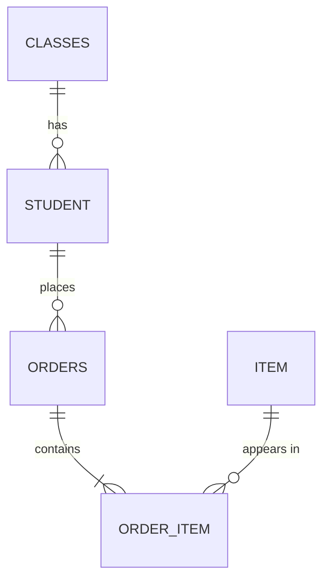

# Week 5, Challenge 2: Normalising the uniform order form

## 1. The repeating group

The `items (item_code, item_name, unit_price, size, qty)` column. One order contains **several** items, so that cell holds a list of groups of values. It is not atomic.

## 2. First normal form (1NF)

Give each item its own row and repeat the order information.

| order_no | order_date | student_id | student_name | class | class_teacher | item_code | item_name | unit_price | size | qty |
|----------|------------|------------|--------------|-------|---------------|-----------|-----------|-----------:|------|----:|
| 501 | 2026-01-05 | S101 | Aisha Rahman | 3A | Mr Lee | U1 | PE Shirt | 12.00 | M | 2 |
| 501 | 2026-01-05 | S101 | Aisha Rahman | 3A | Mr Lee | U2 | PE Shorts | 10.00 | M | 2 |
| 502 | 2026-01-06 | S102 | Ben Tan | 3B | Mrs Pillai | U1 | PE Shirt | 12.00 | L | 1 |
| 503 | 2026-01-08 | S101 | Aisha Rahman | 3A | Mr Lee | U3 | School Tie | 6.00 | One size | 1 |
| 503 | 2026-01-08 | S101 | Aisha Rahman | 3A | Mr Lee | U1 | PE Shirt | 12.00 | S | 1 |

**Primary key:** the composite key `(order_no, item_code)`. An order never has the same item code on two lines.

## 3. Functional dependencies

```
order_no                ->  order_date, student_id
student_id              ->  student_name, class
class                   ->  class_teacher
item_code               ->  item_name, unit_price
(order_no, item_code)   ->  size, qty
```

`size` is determined by the **pair**: Aisha's PE shirt in order 501 is size M, but in order 503 it is size S, so neither `order_no` nor `item_code` alone determines it.

## 4. Second normal form (2NF)

**Partial dependencies** (non-key attributes that depend on only part of `(order_no, item_code)`):

- `order_date`, `student_id`, `student_name`, `class`, `class_teacher` depend only on `order_no`.
- `item_name`, `unit_price` depend only on `item_code`.

Only `size` and `qty` depend on the whole key. Split into three tables:

```
ORDER_ITEM(order_no, item_code, size, qty)
ITEM(item_code, item_name, unit_price)
ORDERS(order_no, order_date, student_id, student_name, class, class_teacher)
```

## 5. Third normal form (3NF)

**Transitive dependencies** in `ORDERS`:

```
order_no -> student_id -> student_name, class
order_no -> student_id -> class -> class_teacher
```

`student_name` and `class` are determined by `student_id` (not the key of `ORDERS`), and `class_teacher` is determined by `class` (also a non-key). Move each into its own table:

```
CLASSES(class, class_teacher)
STUDENT(student_id, student_name, class)
```

## 6. Final tables

```
CLASSES(class PK, class_teacher)
STUDENT(student_id PK, student_name, class FK -> CLASSES)
ITEM(item_code PK, item_name, unit_price)
ORDERS(order_no PK, order_date, student_id FK -> STUDENT)
ORDER_ITEM(order_no PK FK -> ORDERS, item_code PK FK -> ITEM, size, qty)
```



## 7. Anomalies in the 1NF table that the 3NF design removes

| Anomaly | Example |
|---------|---------|
| **Update** | Mr Lee is replaced as the 3A class teacher. We must change `class_teacher` in **every** row for every 3A student's order lines (three rows here). Missing one leaves contradictory data. (Same idea: a price change for the PE Shirt appears in three rows.) |
| **Insert** | We want to record a new item `U4 School Bag, 25.00` before anyone orders it, or a new student who has not ordered yet. We cannot: every row needs an `order_no`. |
| **Delete** | Order 502 is cancelled and deleted. We lose the only record that student `S102 Ben Tan` is in class 3B with teacher Mrs Pillai. (Likewise, deleting order 503's `U3` line would lose the only record of the School Tie.) |

## Marking notes

- Full marks for the final design need **five** tables, correct keys, and the composite key on `ORDER_ITEM`.
- A common mistake is putting `size` in `ITEM`. In this form, the same item has different sizes in different orders, so `size` depends on the order line and belongs in `ORDER_ITEM`.
- Some students will leave `class_teacher` in `STUDENT`, stopping at 2NF. Ask: *if Mr Lee is replaced, how many rows must change?*
