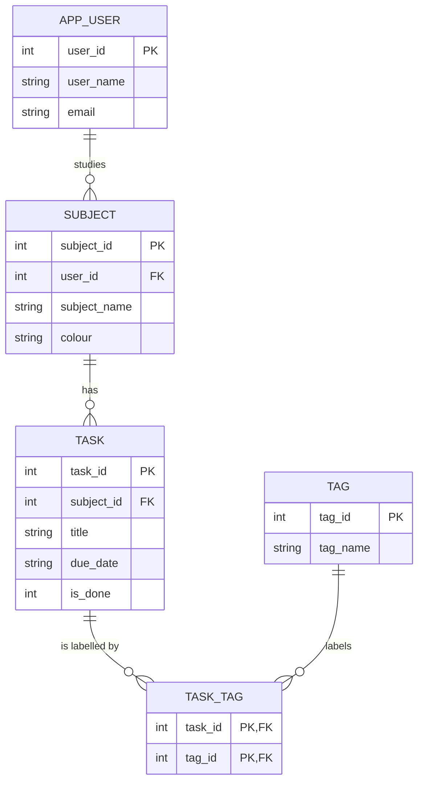

# Week 5, Challenge 4: Sample design (a homework planner)

Students' apps will differ. This sample meets every requirement, and shows what a good answer looks like. Runnable SQL: [challenge-4-sample.sql](challenge-4-sample.sql).

## Entities and ER diagram

The **many-to-many** relationship is between TASK and TAG: a task can have several tags (`exam`, `group-work`) and a tag labels many tasks. It is resolved by the junction table TASK_TAG.

## Data dictionary

| Table | Column | Type | Key | Notes |
|-------|--------|------|-----|-------|
| app_user | user_id | INTEGER | PK | |
| app_user | user_name | TEXT | | required |
| app_user | email | TEXT | | required, unique |
| subject | subject_id | INTEGER | PK | |
| subject | user_id | INTEGER | FK -> app_user | each user keeps their own subjects |
| subject | subject_name | TEXT | | required |
| subject | colour | TEXT | | for the calendar view |
| task | task_id | INTEGER | PK | |
| task | subject_id | INTEGER | FK -> subject | |
| task | title | TEXT | | required |
| task | due_date | TEXT | | `YYYY-MM-DD` |
| task | is_done | INTEGER | | 0 = not done, 1 = done |
| tag | tag_id | INTEGER | PK | |
| tag | tag_name | TEXT | | required, unique |
| task_tag | task_id | INTEGER | PK, FK -> task | |
| task_tag | tag_id | INTEGER | PK, FK -> tag | |

## Why every table is in 3NF

| Table | Functional dependencies |
|-------|-------------------------|
| app_user | `user_id -> user_name, email` |
| subject | `subject_id -> user_id, subject_name, colour` |
| task | `task_id -> subject_id, title, due_date, is_done` |
| tag | `tag_id -> tag_name` |
| task_tag | no non-key attributes (the key is the whole row) |

Every non-key attribute depends on the key, the whole key, and nothing else. **A design decision worth pointing out:** `task` does **not** store `user_id`. A task's user can be found through its subject (`task -> subject -> user`). Storing `user_id` in `task` as well would be a transitive dependency (`task_id -> subject_id -> user_id`), and the two could disagree.

## Questions the design can answer

| Question | Tables joined |
|----------|---------------|
| Which tasks of user 1 are due this week and not done? | `app_user`, `subject`, `task` |
| How many unfinished tasks does each subject have, including subjects with none? | `subject` LEFT JOIN `task` |
| Which tasks have the tag `exam`? | `task`, `task_tag`, `tag` |
