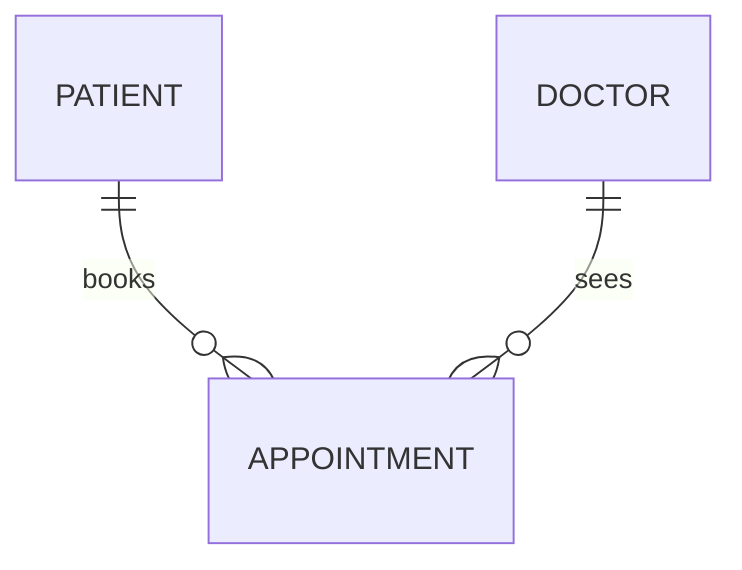

# Week 5 Extra Practice: Answers

## 1. Spot the anomalies

### Table A: library loans

- **Primary key:** `loan_id`.
- **Functional dependencies:**
  ```
  loan_id    ->  member_id, book_id, loan_date
  member_id  ->  member_name, member_address
  book_id    ->  title, author
  ```
- **Highest normal form: 2NF.** The key is a single column, so there can be no partial dependencies. It is **not** in 3NF: `member_name` and `member_address` depend on `member_id`, and `title` and `author` depend on `book_id`, which are non-key columns (transitive dependencies).
- **Anomalies:**
  - *Update:* Aisha moves house, so her address must change in every one of her loan rows (two here).
  - *Insert:* the library cannot record a new member who has not borrowed anything yet, or a new book that has not been borrowed, because every row needs a `loan_id`.
  - *Delete:* deleting loan 2 deletes the only record that book B2 (Emma) exists.
- **3NF:**
  ```
  MEMBER(member_id PK, member_name, member_address)
  BOOK(book_id PK, title, author)
  LOAN(loan_id PK, member_id FK, book_id FK, loan_date)
  ```
  (If the same author wrote many books, `author` could become its own table too. This is optional at this level.)

### Table B: class results

- **Primary key:** `(student_id, subject_id)`.
- **Dependencies:**
  ```
  student_id              ->  student_name
  subject_id              ->  subject_name
  (student_id, subject_id) ->  score
  ```
- **Highest normal form: 1NF.** It fails 2NF: `student_name` depends only on `student_id`, and `subject_name` only on `subject_id` (partial dependencies).
- **Anomalies:**
  - *Update:* renaming "Mathematics" means updating every row for that subject.
  - *Insert:* we cannot add a new subject until a student has a score in it.
  - *Delete:* deleting Tabitha's only score erases the fact that she is a student at all.
- **3NF:**
  ```
  STUDENT(student_id PK, student_name)
  SUBJECT(subject_id PK, subject_name)
  SCORE(student_id PK FK, subject_id PK FK, score)
  ```

### Table C: staff

- **Primary key:** `staff_id`.
- **Dependencies:**
  ```
  staff_id   ->  staff_name, dept_code
  dept_code  ->  dept_name, dept_head
  ```
- **Highest normal form: 2NF** (single-column key). It fails 3NF: `dept_name` and `dept_head` depend on `dept_code`, which is not the key (transitive dependency).
- **Anomalies:**
  - *Update:* a new head of Mathematics means changing every Mathematics teacher's row.
  - *Insert:* a new department cannot be recorded until it has a teacher.
  - *Delete:* deleting Ms Rahman (T2) loses the only record of the Computing department and its head.
- **3NF:**
  ```
  DEPARTMENT(dept_code PK, dept_name, dept_head)
  STAFF(staff_id PK, staff_name, dept_code FK)
  ```

## 2. Exam-style design questions

### Question 1: the clinic

**(a)** `appointment_id`.

**(b)**
```
appointment_id  ->  appt_date, appt_time, patient_id, doctor_id
patient_id      ->  patient_name, patient_phone
doctor_id       ->  doctor_name, doctor_room
```

**(c)** `patient_name` and `patient_phone` depend on `patient_id`, and `doctor_name` and `doctor_room` depend on `doctor_id`. Neither is the primary key, so these are **transitive dependencies**, which are not allowed in 3NF.

**(d)**
```
PATIENT(patient_id PK, patient_name, patient_phone)
DOCTOR(doctor_id PK, doctor_name, doctor_room)
APPOINTMENT(appointment_id PK, appt_date, appt_time, patient_id FK, doctor_id FK)
```

**(e)**


### Question 2: the tuition centre

**(a)** TUTOR, CLASS, STUDENT, SESSION (one meeting of a class on a date).

**(b)**

| Relationship | Type |
|--------------|------|
| A tutor teaches many classes; a class has exactly one tutor | 1:M |
| A class has many sessions; a session belongs to one class | 1:M |
| A student attends many classes; a class has many students | **M:N** |
| A student attends many sessions; a session has many students (attendance) | **M:N** |

**(c)** Two junction tables:

- `ENROLMENT(student_id, class_id, enrol_date)`, key `(student_id, class_id)`.
- `ATTENDANCE(student_id, session_id, present)`, key `(student_id, session_id)`.

**(d)**
```mermaid
erDiagram
    TUTOR ||--o{ CLASS : "teaches"
    CLASS ||--o{ SESSION : "has"
    STUDENT ||--o{ ENROLMENT : "has"
    CLASS ||--o{ ENROLMENT : "has"
    STUDENT ||--o{ ATTENDANCE : "has"
    SESSION ||--o{ ATTENDANCE : "has"
```

### Question 3: short answers

**(a)** 2NF removes **partial dependencies**: non-key attributes that depend on only part of a composite key. 3NF removes **transitive dependencies**: non-key attributes that depend on another non-key attribute.

**(b)** A **foreign key** is a column (or set of columns) in one table whose values refer to the primary key of another table. **Referential integrity** is the rule that every foreign key value must match an existing primary key value in the table it refers to (or be NULL, if allowed), so that there are no "orphan" rows.

**(c)** *Partly right:* a normalised database spreads data over more tables, so some queries need joins, which cost a little more processing time and are longer to write. *Still worth doing:* each fact is stored once, so there is less wasted storage, no update, insert or delete anomalies, and the data stays consistent.

## 3. Reverse-engineer `school.db`

1. ```mermaid
   erDiagram
       STUDENTS ||--o{ SCORES : "has"
       SUBJECTS ||--o{ SCORES : "has"
       STUDENTS ||--o{ STUDENT_CCA : "joins"
       CCAS ||--o{ STUDENT_CCA : "has"
   ```
2. All four relationships are 1:M. The foreign keys are in `scores` (`student_id`, `subject_id`) and in `student_cca` (`student_id`, `cca_id`), always on the "many" side. Together they resolve two many-to-many relationships: students-subjects and students-CCAs.
3. `scores` and `student_cca` are both junction tables, because each has a composite primary key made of two foreign keys. `scores` has a non-key attribute, `score`, because the score describes the *pairing* (this student in this subject), not the student alone or the subject alone, just like `role` in `student_cca`.
4. Yes. In each table every non-key attribute depends on the key only. `students.class` is only a label here: the database stores nothing else about a class, so there is no transitive dependency. If we added `class_teacher` to `students`, then `student_id -> class -> class_teacher` would break 3NF, and we would need a separate `classes` table (as in Challenge 2).

## 4. Peer review

No fixed answers. Check that each student wrote one specific positive comment and one specific, actionable suggestion (for example "the line between STUDENT and CLUB is still many-to-many, so it needs a junction table").
