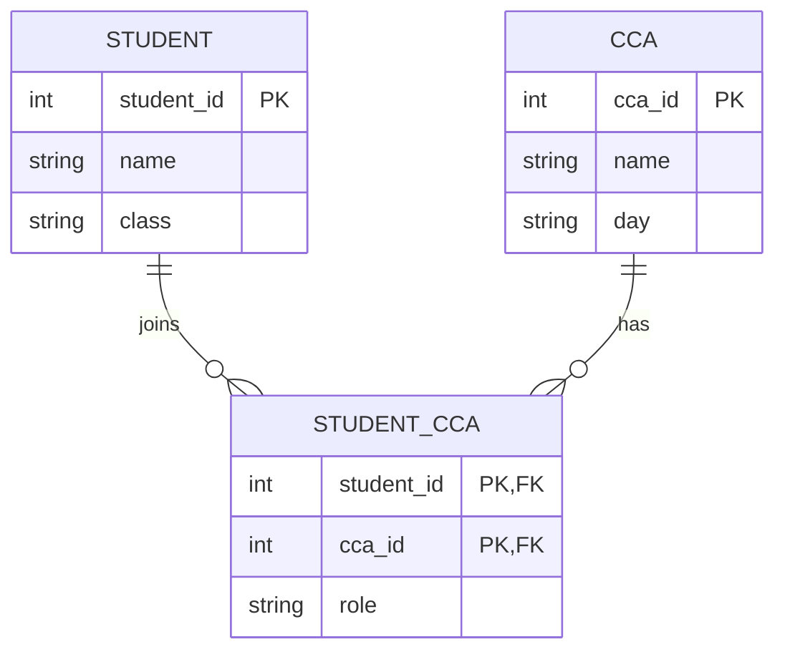
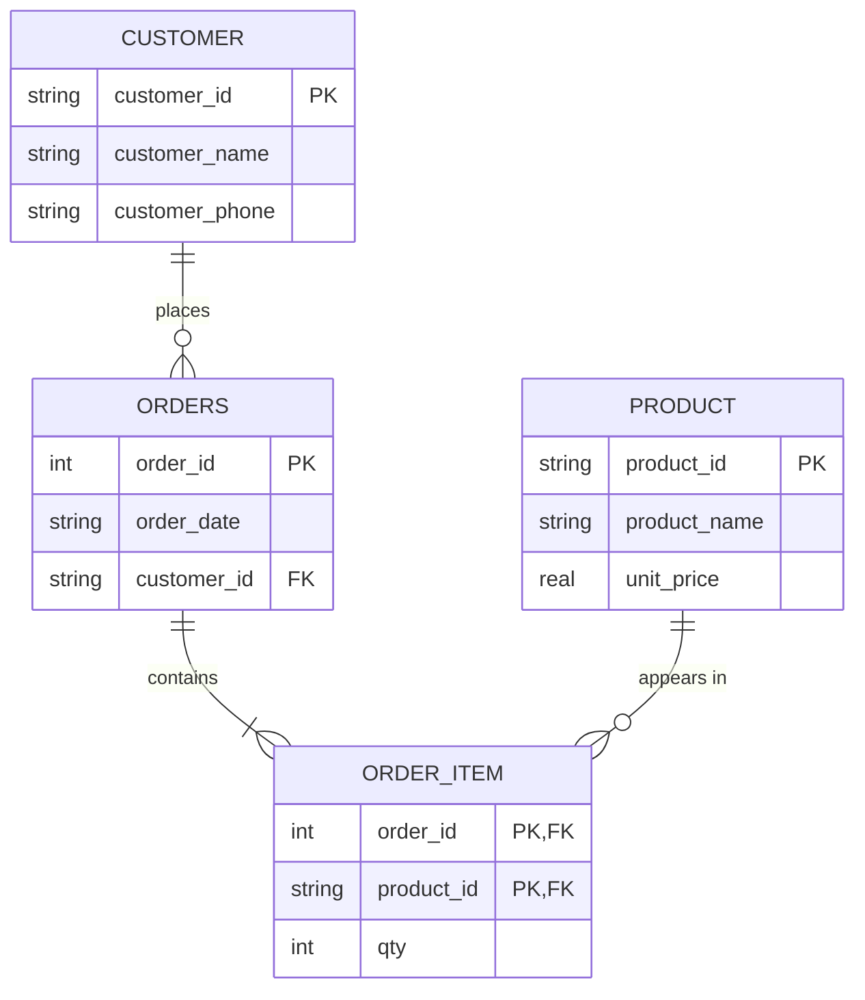

# Week 5 Demo: ER diagrams and normalisation

**Time:** 45 minutes. Students draw on paper (or iPad) and then type the SQL.
**Code:** [demo/club.sql](demo/club.sql), [demo/orders_3nf.sql](demo/orders_3nf.sql)

---

## Part 1: Entities, attributes and relationships (15 min)

### Vocabulary

| Term | Meaning | Example |
|------|---------|---------|
| **Entity** | A thing we store data about. Becomes a **table** | Student, CCA, Subject |
| **Attribute** | A property of an entity. Becomes a **column** | name, class, dob |
| **Identifier** | The attribute(s) that uniquely identify an entity instance. Becomes the **primary key** | `student_id` |
| **Relationship** | A link between entities. Implemented with a **foreign key** | A student *joins* a CCA |
| **Cardinality** | How many instances can be linked | one-to-many |

### Three kinds of relationship

**One-to-one (1:1).** A student may be assigned at most one locker. A locker belongs to at most one student.

**One-to-many (1:M).** One class has many students. Each student is in exactly one class. *The foreign key goes on the "many" side* (`students.class`).

**Many-to-many (M:N).** A student can join many CCAs. A CCA has many students. This **cannot** be stored with a single foreign key.

Ask: *where would you put the key to link `students` and `ccas`?* Try it live: if `ccas` had a `student_id` column, a CCA could only have one student; if `students` had a `cca_id` column, a student could only be in one CCA. Neither works.

### Resolving a many-to-many relationship

Add a **junction table** (also called a link or associative table) in the middle. It holds the primary keys of both sides as foreign keys, and any attribute of the *relationship itself*:



The M:N became **two** 1:M relationships. The primary key of the junction table is the pair `(student_id, cca_id)`: a student cannot join the same CCA twice. `role` (Member/Leader) belongs to the junction table because it describes the student *in that CCA*, not the student alone and not the CCA alone.

### Crow's foot notation

| Symbol | Meaning |
|--------|---------|
| `\|\|` | exactly one |
| `o\|` | zero or one |
| `\|{` | one or many |
| `o{` | zero or many |

Read the line `CCA ||--o{ STUDENT_CCA` as: *"one CCA appears in zero or many STUDENT_CCA rows."* Compare with the school's real data: Chess Club has zero members, so "zero or many" is correct.

---

## Part 2: Normalisation (20 min)

### Why bother? Anomalies

Show this one flat table. It is the "order form" a shop might keep in a spreadsheet:

| order_id | order_date | customer_id | customer_name | customer_phone | product_id | product_name | unit_price | qty |
|----------|------------|-------------|---------------|----------------|------------|--------------|-----------:|----:|
| 1001 | 2026-03-02 | C1 | Ahmad bin Ali | 91234567 | P1 | Pen | 1.20 | 10 |
| 1001 | 2026-03-02 | C1 | Ahmad bin Ali | 91234567 | P2 | Notebook | 3.50 | 2 |
| 1002 | 2026-03-03 | C2 | Mei Ling Tan | 98765432 | P1 | Pen | 1.20 | 5 |
| 1003 | 2026-03-05 | C1 | Ahmad bin Ali | 91234567 | P3 | Ruler | 0.90 | 4 |
| 1003 | 2026-03-05 | C1 | Ahmad bin Ali | 91234567 | P2 | Notebook | 3.50 | 1 |

Ask what goes wrong. The same facts are stored again and again (**redundancy**), and that causes three kinds of **anomaly**:

| Anomaly | Example in this table |
|---------|-----------------------|
| **Update** | Ahmad changes his phone number. We must change it in **four** rows. Miss one, and the data contradicts itself. |
| **Insert** | The shop starts selling a new product, `P4 Eraser`. We cannot record it until somebody orders it, because every row needs an `order_id`. |
| **Delete** | Order 1003 is cancelled and deleted. We lose the only record that product `P3 Ruler` exists and what it costs. |

**Normalisation** is the step-by-step process of restructuring tables to remove these problems.

### Step 0: Unnormalised form (UNF)

On paper, the order form looks like this, with a **repeating group** of items inside one order:

| order_id | order_date | customer_id | customer_name | customer_phone | items (product_id, product_name, unit_price, qty) |
|----------|------------|-------------|---------------|----------------|-------|
| 1001 | 2026-03-02 | C1 | Ahmad bin Ali | 91234567 | (P1, Pen, 1.20, 10), (P2, Notebook, 3.50, 2) |
| 1002 | 2026-03-03 | C2 | Mei Ling Tan | 98765432 | (P1, Pen, 1.20, 5) |
| 1003 | 2026-03-05 | C1 | Ahmad bin Ali | 91234567 | (P3, Ruler, 0.90, 4), (P2, Notebook, 3.50, 1) |

### Step 1: First normal form (1NF)

**Rule:** every cell holds **one value** (atomic), there are **no repeating groups**, and there is a primary key.

Give each item its own row. The primary key becomes the **composite key** `(order_id, product_id)`. This is exactly the flat table shown above.

```
ORDER_LINE(order_id, product_id, order_date, customer_id, customer_name, customer_phone,
           product_name, unit_price, qty)
```

### Step 2: Second normal form (2NF)

**Rule:** be in 1NF, and have **no partial dependencies**: no non-key attribute may depend on only *part* of a composite key.

List the **functional dependencies** (what determines what):

```
order_id                 ->  order_date, customer_id, customer_name, customer_phone
product_id               ->  product_name, unit_price
(order_id, product_id)   ->  qty
```

`order_date` depends on `order_id` alone, and `product_name` on `product_id` alone. Those are partial dependencies. Split the table so every attribute depends on the *whole* key of its table:

```
ORDER(order_id, order_date, customer_id, customer_name, customer_phone)
PRODUCT(product_id, product_name, unit_price)
ORDER_ITEM(order_id, product_id, qty)
```

### Step 3: Third normal form (3NF)

**Rule:** be in 2NF, and have **no transitive dependencies**: no non-key attribute may depend on another non-key attribute.

In `ORDER`:

```
order_id -> customer_id -> customer_name, customer_phone
```

`customer_name` is determined by `customer_id`, which is not the key of `ORDER`. That is a **transitive dependency**. Move the customer attributes out:

```
CUSTOMER(customer_id, customer_name, customer_phone)
ORDER(order_id, order_date, customer_id)          customer_id is a foreign key
PRODUCT(product_id, product_name, unit_price)
ORDER_ITEM(order_id, product_id, qty)             both are foreign keys
```

### Check the anomalies are gone

- **Update:** Ahmad's phone is stored once, in `CUSTOMER`.
- **Insert:** a new product goes straight into `PRODUCT`.
- **Delete:** deleting order 1003 does not remove any product or customer.

### Summary on the board

> Every non-key attribute depends on **the key** (1NF), **the whole key** (2NF), and **nothing but the key** (3NF).

### The final ER diagram



(The table is named `ORDERS` in the diagram because `ORDER` is a reserved word in SQL.)

---

## Part 3: From design to SQLite (10 min)

Week 6 teaches `CREATE TABLE` properly. For now, show the pattern with the junction table from Part 1, then students copy it.

```sql
CREATE TABLE club (
    club_id  INTEGER PRIMARY KEY,
    name     TEXT NOT NULL
);

CREATE TABLE member (
    member_id INTEGER PRIMARY KEY,
    name      TEXT NOT NULL
);

CREATE TABLE membership (                    -- the junction table
    member_id INTEGER,
    club_id   INTEGER,
    role      TEXT,
    PRIMARY KEY (member_id, club_id),        -- composite primary key
    FOREIGN KEY (member_id) REFERENCES member (member_id),
    FOREIGN KEY (club_id)   REFERENCES club (club_id)
);

INSERT INTO club VALUES (1, 'Robotics');
INSERT INTO member VALUES (1, 'Aisha');
INSERT INTO membership VALUES (1, 1, 'Leader');
```

- Read the pattern aloud: a column list, then `PRIMARY KEY (...)`, then one `FOREIGN KEY (...) REFERENCES table (column)` line per foreign key.
- `INSERT INTO table VALUES (...)` adds a row, with values in column order.
- SQLite checks foreign keys only if you first run `PRAGMA foreign_keys = ON;` (Week 6 explains why).
- Run the full demo script, then the 3NF order database, and show that a join reassembles the original order form:

```sql
SELECT o.order_id, o.order_date, c.customer_name, p.product_name, p.unit_price, i.qty
FROM orders AS o
JOIN customer AS c ON c.customer_id = o.customer_id
JOIN order_item AS i ON i.order_id = o.order_id
JOIN product AS p ON p.product_id = i.product_id
ORDER BY o.order_id, p.product_id;
```

This is the heart of the idea: **we store each fact once, and use joins to bring the facts back together.**

Files: [demo/club.sql](demo/club.sql), [demo/orders_3nf.sql](demo/orders_3nf.sql). Run with `sqlite3 my-work/demo.db` then `.read week-05-database-design/demo/orders_3nf.sql`.

---

## Check for understanding

1. How do you implement a many-to-many relationship?
2. A table has the key `(student_id, subject_id)` and the column `subject_name`. Which normal form does it break, and why? *(2NF: `subject_name` depends on `subject_id` only.)*
3. A table has `student_id -> class -> class_teacher`. Which normal form does it break? *(3NF: transitive dependency.)*
