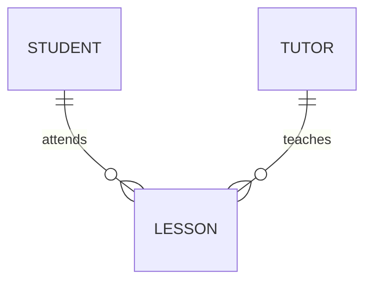

# Week 10 Extra Practice: Answers

## 1. Peer review of a plan

Answers vary. Look for specific, kind, actionable comments (not "looks good"). A useful review names a *line* in the plan, says what is wrong and suggests a change.

## 2. Git practice

After step 3 Git reports `CONFLICT (content): Merge conflict in templates/base.html` and the file contains:

```
<<<<<<< HEAD
<title>Version from main</title>
=======
<title>Version from practice</title>
>>>>>>> practice
```

Everything above `=======` is from the branch you are on (`main`); everything below is from the branch being merged (`practice`). Edit the file to contain the one line you want, **delete the three marker lines**, then `git add templates/base.html` and `git commit` (Git suggests a message). `git log --oneline --graph` shows two lines of history that join in a merge commit. The most important lessons: conflicts happen only when the *same lines* were changed; they are normal; and the fix is to decide, not to panic. To abandon a merge: `git merge --abort`.

## 3. A stretch feature

Mark against the brief. See [Week 9's extra practice answers](../../week-09-flask-sqlite-crud/Answers/extra-practice-answers.md) for sorting and pagination, and `model-capstone/app.py` for a second report.

## 4. Written questions (40 marks)

### Q1: HTML [4]

(a) `for` on a `<label>` holds the `id` of the input it describes: clicking or tapping the label focuses the input, and screen readers announce the label with the field. [1] The `name` attribute is the key under which the browser sends the value (`request.form["name"]` in Flask); an input without a `name` is not sent. [1]
(b) Any two [1 each]: the meaning of the page is clear to browsers, search engines and screen-reader users (they can jump to the navigation or main content); the code is easier to read and maintain; default accessibility behaviours and landmarks are built in; styling hooks are clearer than a page of unnamed `div`s.

### Q2: SQL queries [6]

(a) [4]
```sql
SELECT s.name, AVG(sc.score) AS average
FROM students AS s
JOIN scores AS sc ON sc.student_id = s.student_id
GROUP BY s.student_id, s.name
HAVING AVG(sc.score) > 70
ORDER BY average DESC;
```
[1] join on `student_id`; [1] `GROUP BY` the student; [1] `HAVING` (not `WHERE`) with the aggregate; [1] `ORDER BY` descending. Run on the course database it returns 12 students, starting with Siti Nurhaliza (79.8), Tiffany Goh (79.0) and Rahul Sharma (78.8), and ending with Arjun Menon and Deepa Krishnan (72.0).

(b) `COUNT(*)` counts every row, but `COUNT(email)` counts only rows where `email` is **not NULL**. With 5 missing emails in the course database they return 30 and 25. [1] `NULL` means "unknown", and a comparison with an unknown value is not true, not even `NULL = NULL`, so `= NULL` never matches. The correct test is `WHERE email IS NULL`. [1]

### Q3: Database design [8]

(a) Any two [1 each, with an example]: **update anomaly**: a tutor's phone number is repeated in every lesson, so changing it means changing many rows, and missing one leaves two different numbers; **insert anomaly**: a new tutor cannot be recorded until they have a lesson (or a student before their first lesson); **delete anomaly**: deleting a student's only lesson also loses the student's phone number; **redundancy** wastes space.

(b) [3] One mark for each correct entity set (student, tutor, lesson) and relationship: Student 1-to-many Lesson; Tutor 1-to-many Lesson (so Student and Tutor are many-to-many, resolved by Lesson). Include crow's foot or cardinality labels.



(c) [3]
```
STUDENT(student_id PK, student_name, student_phone)
TUTOR(tutor_id PK, tutor_name, tutor_phone, subject)
LESSON(lesson_id PK, student_id FK, tutor_id FK, lesson_date, fee)
```
[1] each table. Because a tutor teaches one subject, `subject` depends on the tutor and belongs in `TUTOR`. (A separate `SUBJECT` table with `subject_id` as a foreign key in `TUTOR` is also correct and slightly better.) Marks are lost for a `LESSON` table that still contains tutor or student details, or for missing foreign keys.

### Q4: Flask [6]

(a) [3, one each] `render_template` fills a Jinja template with data and returns the HTML to send to the browser. `redirect` sends the browser a response telling it to request another URL. `url_for` builds the URL of a route from the name of its function (and values for its variables), so links remain correct when URLs change.

(b) After a successful POST the server does not show a page directly; it **redirects** the browser to a GET page (for example the list). [1] Without this, the browser's page is the result of a POST, so pressing refresh or the back button re-sends the form and repeats the action (for example saving the same record twice). [1] With it, a refresh repeats only the harmless GET. [1]

### Q5: Security [6]

(a) [4] **SQL injection** [2]: the name is placed in the SQL text with an f-string, so `' OR '1'='1` returns every student, and a `UNION SELECT` can read other tables. **Cross-site scripting (XSS)** [2]: the name is added to the HTML by string concatenation without escaping, so `<script>...</script>` in the URL runs in the visitor's browser (an attacker can put the link in a message).

(b) [2]
```python
rows = get_db().execute("SELECT * FROM students WHERE name = ?", (name,)).fetchall()
return render_template("results.html", name=name, rows=rows)    # Jinja escapes the values
```
[1] placeholder with a one-item tuple; [1] a template (or `markupsafe.escape`) instead of concatenation.

### Q6: Transactions and constraints [4]

(a) `with db:` groups the statements into one **transaction**: if both succeed they are committed together; if either raises an error everything is rolled back. [1] This avoids a half-finished change, such as a loan recorded but the kit's quantity not updated. [1]
(b) Any two [1 each]: `CHECK (qty >= 1)` on `loan.qty`; `FOREIGN KEY (kit_id) REFERENCES kit (kit_id)` with `PRAGMA foreign_keys = ON`; `NOT NULL` on `kit_id` and `qty`.

### Q7: Testing [3]

One mark for each distinct, well described test (what is tested, the input, the expected result). Good examples: a **valid** booking is saved (the database has the new row and the response is a redirect); an **invalid** booking (empty name, quantity zero) is rejected, the form is shown again with a message and nothing is saved; a booking for a **full or unavailable** slot is refused; a booking for an unknown id gives a 404; a GET request to a POST-only route gives 405; dangerous input (`' OR 1=1 --`) is stored as text or rejected and does not damage the database.

### Q8: Evaluation [3]

Advantages of the stored column [1]: reading availability is simple and fast, with no join or sum. Disadvantages [1]: it is **redundant**: the number can be calculated from `total_qty` and the open loans, and two copies of the same fact can disagree (for example the program crashes after inserting a loan but before updating the column, or an edit changes one but not the other); every code path that changes a loan must remember to update it (a cause of bugs). Alternative [1]: calculate availability when needed with a `LEFT JOIN` and `SUM` of the loans that are not yet returned (or a database `VIEW`). If speed ever became a problem, a stored value could be kept up to date inside one transaction, with tests to prove it.
