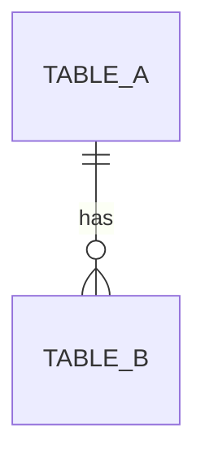

# My capstone plan

Fill this in during Week 10 (Challenge 1) and show it to your instructor before you start coding. Keep it short and honest: a plan you can finish is better than a plan you cannot.

## 1. The idea

**Project name:**

**One sentence: who is it for, and what problem does it solve?**
(Example: "It helps the Robotics Club know which kits are out, so nothing goes missing.")

**Who are the users?** (Name at least two kinds, for example "club teacher" and "student member".)

## 2. User stories (at least 6)

Write each as: *As a ___, I want to ___ so that ___.*

1.
2.
3.
4.
5.
6.

## 3. Must have (MVP) and stretch goals

**Must have (finish these first; every one is a user story above):**
- [ ]
- [ ]
- [ ]

**Stretch goals (only after the must-haves work):**
- [ ]
- [ ]

## 4. Database design

**Entities and their attributes:**

| Table | Columns (mark the primary key PK and foreign keys FK) | Rules (NOT NULL, UNIQUE, CHECK...) |
|-------|--------------------------------------------------------|-------------------------------------|
|       |                                                        |                                     |
|       |                                                        |                                     |
|       |                                                        |                                     |

**ER diagram:** draw it on paper and add a photo, or write it in Mermaid:

````

````

**Normalisation check:** Is every table in 3NF? Write one sentence for your most complex table: *"Every non-key column depends on the key, the whole key, and nothing but the key because ..."*

## 5. Pages and routes

| Page | URL | Methods | What it does (SQL used) |
|------|-----|---------|-------------------------|
| Home / list | `/` | GET | |
| | | | |
| | | | |
| | | | |

## 6. Features checklist (from the assessment brief)

- [ ] At least **two related tables** with a foreign key
- [ ] **Create, Read, Update and Delete** for at least one table
- [ ] **Search or filter** using a GET form
- [ ] A **report** page that uses `GROUP BY` or a join
- [ ] **Validation** with friendly error messages, on the server
- [ ] `?` placeholders in **every** query
- [ ] POST + redirect, flash messages
- [ ] Base template, CSS, works on an iPad
- [ ] **Tests** (Week 11) and a **README** (Week 11)

## 7. Risks

What might go wrong, and what will you do about it? (Example: "I might run out of time, so reports are a stretch goal.")

## 8. Week plan

| When | Goal |
|------|------|
| Week 10 (today) | Plan, database, first page (list + add) |
| Home / between sessions | |
| Week 11 | Tests, polish, README, demo |
