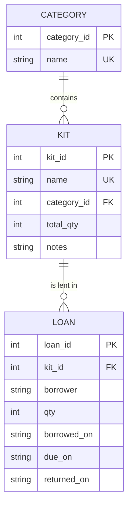

# Robotics Club Kit Loans

A small web app that helps a school robotics club keep track of its equipment: which kits it owns, how many are available, who has borrowed what, and who is late returning it.

*This is the instructor's reference project for the capstone (a model of the quality expected, including the README and the tests). It is not a project idea for students to copy.*

## The problem

The teacher used a paper list. Kits went missing, and nobody knew whether 3 Arduinos were out or 5. This app replaces the list with a database that works out availability from the loan records.

## Features

| Page | URL | What it does |
|------|-----|--------------|
| Kit list | `/` | All kits with how many are available; search by name; filter by category |
| Kit page | `/kits/<id>` | Details, full loan history, lend form, return buttons |
| Add / edit kit | `/kits/new`, `/kits/<id>/edit` | Create and update with validation (cannot set the total below the number out) |
| Delete kit | `POST /kits/<id>/delete` | Only if the kit has never been lent (history is kept) |
| Categories | `/categories` | Add a category; delete one only if it is empty |
| Overdue loans | `/overdue` | Loans past the due date, most late first |
| Report | `/report` | Kits and loans by category, borrowers ranked, kits never borrowed |

## Run it

```bash
pip install -r requirements.txt
flask --app app init-db          # creates instance/app.db from schema.sql and seed.sql (deletes any existing data)
flask --app app run --debug      # then open port 5000
```

Run the tests: `python3 -m unittest discover -s tests -v` (21 tests, about a quarter of a second).

## Database design



All three tables are in **3NF**: every non-key column depends on its table's key and nothing else. The number of kits *available* is not stored; it is calculated as `total_qty` minus the quantity in loans that have no `returned_on` date, so it cannot get out of step with the loans. The database enforces `NOT NULL`, `UNIQUE`, `CHECK` and `FOREIGN KEY` rules (for example `qty >= 1` and `due_on >= borrowed_on`), and `PRAGMA foreign_keys = ON` is set for every connection.

## Design decisions

- **Borrower is a name, not a table.** There is no login in this version. If the club needs contact details, `borrower` should become a `member` table.
- **History is kept.** A kit with loans cannot be deleted; a returned loan stays in the table with its date.
- **Security:** every query uses `?` placeholders; every change is a POST followed by a redirect; Jinja escapes all output; the secret key is read from the environment.

## Testing

`tests/test_app.py` has 21 tests in five groups: reading (availability sum, search, filter, injection text, 404, overdue calculation, report totals), borrowing and returning (valid, over-borrowing, bad input, return once, GET not allowed), kits and categories (create, validation, duplicates, delete rules, escaping), database rules (the constraints refuse bad rows even if the Python forgot), and the seed data (every page loads). Each test uses its own temporary database and a fixed date.

## Limitations and next steps

- No login: anyone can lend and delete. A next step is a teacher-only login.
- Names are free text, so "Mei" and "Mei Lin" count as different borrowers.
- No email reminders for overdue loans.
- Verified by automated tests only. Checking the layout by eye on a real iPad, and with a screen reader, is still to do.

## What I learned (sample wording, to show the kind of reflection expected)

Students should write about **their own** experience, and be specific. For example: *"The tests for borrowing made me think about what should happen when someone asks for more kits than are available, which I had not planned. Calculating availability instead of storing it meant I never had to keep two numbers in step. Next time I would write the tests earlier, and make the borrower a table."*
