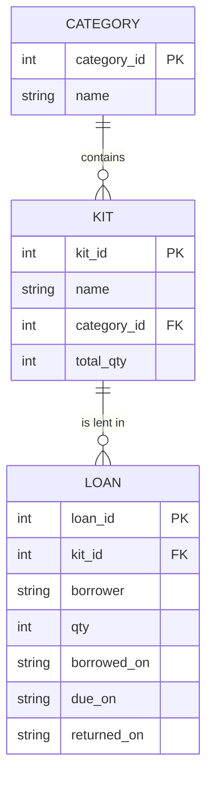

# Week 10 Demo: From idea to first slice

**Time:** 45 minutes. This is a *thinking and building* demo: one example project, planned out loud and then started.
**Example project:** *Robotics Club kit loans.* Teacher Mr Tan wants to know which kits (Arduinos, sensors, motors) are out, who has them, and who is late returning them. A finished version is in [Answers/model-capstone](Answers/model-capstone/): show it *after* the planning, not before.

---

## Part 1: Idea to user stories (10 min)

**Users first.** Ask: *Who will use it?* Two kinds: **the teacher** (manages the kits) and **members** (borrow kits). Never say "users" without naming them.

**User story format:** *As a ___, I want to ___ so that ___.*

1. As a **teacher**, I want to see every kit and how many are available so that I know what I can lend.
2. As a **teacher**, I want to record who borrowed what, how many, and until when so that nothing goes missing.
3. As a **teacher**, I want to mark a loan as returned so that the kit is available again.
4. As a **teacher**, I want a list of overdue loans so that I know whom to remind.
5. As a **teacher**, I want to add, rename and remove kits so that the list matches what we own.
6. As a **member**, I want to search by name or category so that I can find the part I need quickly.

**MVP vs stretch.** Draw a line:

- **MVP (must have):** stories 1, 2, 3, 5 (the list, borrowing, returning, add/edit kits).
- **Stretch:** stories 4 and 6 (overdue report, search), categories management, a statistics page.

*Teaching point:* the MVP must still meet the assessment requirements (CRUD, search and report). Stretch means "beyond what is needed to work". Always build the MVP first so that something works at the end of each session.

## Part 2: The database design (15 min)

**Find the nouns.** In the stories: kit, category, loan, borrower, quantity, due date. Ask of each: *is this a thing with its own details (a table), or a detail of a thing (a column)?*

- `kit` and `category` are things. `loan` is an event that connects a person to a kit.
- `borrower`: could be a table. For the MVP we only need a name, so it is a column of `loan`. *Mention the trade-off*: if we later need the borrower's class and contact, we should make a `member` table. (A design choice. Say it aloud.)

**Relationships.** One category has many kits. One kit has many loans. So:



**Normalisation check, out loud.** *Is "category name" repeated in every kit?* No: it is stored once in `category`. *Is "available quantity" stored?* No: it can be **calculated** (`total_qty` minus quantity on loan), and a stored copy could go out of date. (Do not store what you can compute.)

**Constraints.** For each column, ask: *can it be empty? must it be unique? what range?* This produces [Answers/model-capstone/schema.sql](Answers/model-capstone/schema.sql):

```sql
CREATE TABLE kit (
    kit_id      INTEGER PRIMARY KEY,
    name        TEXT NOT NULL CHECK (length(name) BETWEEN 2 AND 60),
    category_id INTEGER NOT NULL,
    total_qty   INTEGER NOT NULL CHECK (total_qty BETWEEN 1 AND 500),
    notes       TEXT,
    UNIQUE (name),
    FOREIGN KEY (category_id) REFERENCES category (category_id)
);
```

**Seed data.** Write 8 realistic kits (not "Test 1", "Test 2"). Realistic data is how you notice that a name is too long for the page, or that a page looks empty. Include an **overdue** loan and a kit with **no loans** so that every report has something to show and every edge case can be seen.

## Part 3: Pages and routes (5 min)

A *route map* is a table. It is the plan for the whole application:

| Page | URL | Methods | SQL |
|------|-----|---------|-----|
| Kit list (search, filter) | `/` | GET | `SELECT ... LEFT JOIN loan ... GROUP BY` |
| Kit details and history | `/kits/<id>` | GET | `SELECT ... WHERE kit_id = ?` |
| Add / edit kit | `/kits/new`, `/kits/<id>/edit` | GET, POST | `INSERT`, `UPDATE` |
| Delete kit | `/kits/<id>/delete` | POST | `DELETE` (only if no loans) |
| Lend | `/kits/<id>/borrow` | POST | `INSERT INTO loan` |
| Return | `/loans/<id>/return` | POST | `UPDATE loan SET returned_on` |
| Overdue report | `/overdue` | GET | `WHERE returned_on IS NULL AND due_on < ?` |

Sketch two or three of the pages (a wireframe) on paper: boxes for the heading, the table and the form. Take a photo for the plan.

## Part 4: Build the first slice from the template (10 min, live)

A **vertical slice** is one feature built through every layer: database → SQL → route → template. It beats building all the tables, then all the routes, then all the pages, because you have something that works at every stage.

```bash
cp -r week-10-plan-and-build/capstone-template my-work/capstone
cd my-work/capstone
```

1. Replace the tables in `schema.sql` and the rows in `seed.sql`. Run `flask --app app init-db`.
2. Check the database by hand before writing any Python:
   ```bash
   sqlite3 instance/app.db "SELECT * FROM kit LIMIT 3;"
   ```
3. Write the **list page**: the SQL first (try it in `sqlite3`), then the route, then the template.
4. Write the **add form**: validation, `with db:`, `flash`, `redirect`.
5. Run the tests: `python3 -m unittest discover -s tests`.

*Note on calculation.* The list query computes availability with a join and `SUM`:

```sql
SELECT k.name, k.total_qty - COALESCE(SUM(CASE WHEN l.returned_on IS NULL THEN l.qty END), 0) AS available
FROM kit AS k LEFT JOIN loan AS l ON l.kit_id = k.kit_id
GROUP BY k.kit_id;
```

`LEFT JOIN` keeps kits with no loans; `COALESCE(..., 0)` turns the NULL sum into 0; the `CASE` ignores returned loans.

## Part 5: Git, saving and sharing your work (as you go, 5 min)

Git keeps a history of your project so you can go back, compare, and work with a partner. In Codespaces, git is already set up.

```bash
git status                                  # what has changed?
git add my-work/capstone                    # choose what goes in the next snapshot
git commit -m "Add kit list page with availability"     # take the snapshot, with a message
git push                                    # send it to GitHub
```

**Good habits:**

- Commit **small and often**, after each thing that works. "Work in progress" at the end of the day is a bad message; `Add overdue report page` is a good one (start with a verb, say what, keep it under 60 characters).
- **Never commit** secrets (passwords, keys) or the database file (`instance/` is ignored by `.gitignore`).
- Use a **branch** for each feature, so that `main` always works:

```bash
git switch -c feature/overdue-report        # create and move to a new branch
# ...work, commit...
git switch main
git merge feature/overdue-report            # bring the feature into main
git push
```

- `git log --oneline` shows your history; `git diff` shows what changed since the last commit; `git restore <file>` throws away uncommitted changes to a file.
- On the iPad, the **Source Control** icon in the sidebar does the same as these commands with buttons. Either way is fine; the terminal is clearer for learning.

*Assessment link:* the brief asks for at least 10 commits with meaningful messages over both weeks, so start now.

---

## Wrap-up questions

1. Why do we not store the "available" quantity in the `kit` table?
2. Why is the borrower's name a column of `loan` here, and what would make us change it to a table?
3. What is a vertical slice, and why is it a better way to work than building all the tables first and all the pages last?
